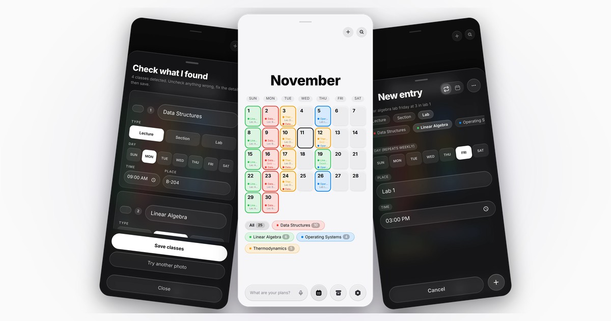
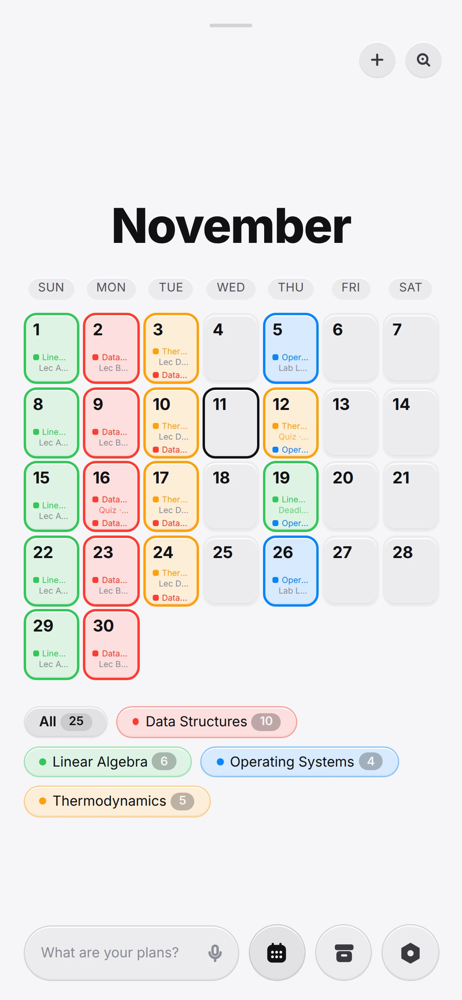
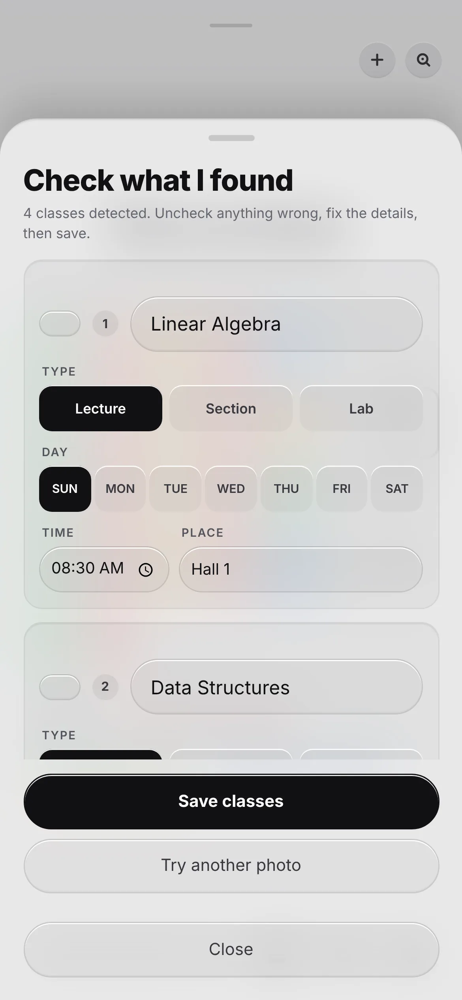
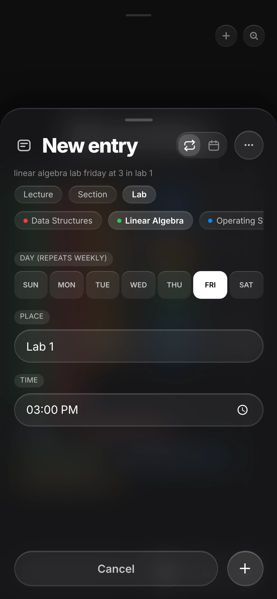
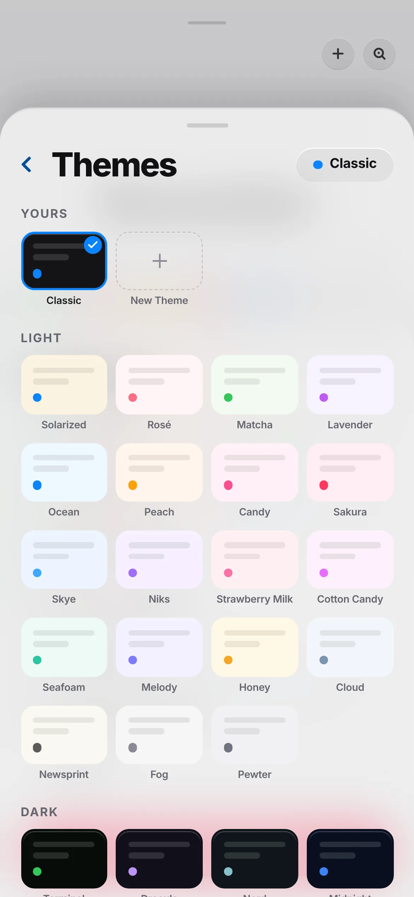

<div align="center">


# Lektra

**Plan your week. Own your semester.**

The marketing site for Lektra — a calm, offline-first study planner for students.

[](https://nextjs.org)
[](https://react.dev)
[](https://tailwindcss.com)
[](https://www.typescriptlang.org)
[](LICENSE)

[**Open the app**](https://ahmedkamalrezk.github.io/Lektra/) · [App source](https://github.com/ahmedkamalrezk/Lektra) · [Report a bug](https://github.com/ahmedkamalrezk/Lektra-web/issues) · [Request a feature](https://github.com/ahmedkamalrezk/Lektra-web/issues)

</div>

<p align="center">
  
</p>

## What is Lektra?

Lektra keeps a semester in one place: lectures, sections, labs, quizzes, midterms,
finals and deadlines. Scan a timetable photo, add the rest by voice, and keep
working when the signal drops. No account, no feed, no ads.

Everything stays on the device, backed up in a small file you own.

<table>
  <tr>
    <td align="center" width="25%"><br /><sub><b>Month &amp; day</b></sub></td>
    <td align="center" width="25%"><br /><sub><b>Timetable scan</b></sub></td>
    <td align="center" width="25%"><br /><sub><b>Voice entry</b></sub></td>
    <td align="center" width="25%"><br /><sub><b>Forty themes</b></sub></td>
  </tr>
</table>

## About this repo

This is the site only — a statically generated Next.js app. The planner itself
lives in [ahmedkamalrezk/Lektra](https://github.com/ahmedkamalrezk/Lektra) and is
linked from every call to action here.

| Page | What it is |
| --- | --- |
| `/` | Landing page: hero, seven app screens with one-line captions, final call to action |
| `/features` | The detail: six core features, install models, every capability, the comparison, privacy |
| `/download` | Install instructions for iPhone, Android and desktop (PWA) |
| `/pricing` | Free, forever — and what that means |
| `/feedback` | Report a bug, suggest a feature, or say hello — opens a pre-filled mail with your message |
| `/privacy` | What stays on your device (everything) |
| `/terms` | Terms of use |

## Tech

- **Next.js 16** (App Router, fully static export, Turbopack in dev)
- **React 19** + **TypeScript**
- **Tailwind CSS 4** for utilities, plus hand-written CSS for the landing sections
- **GSAP + ScrollTrigger** for the scroll-driven section transitions
- **Self-hosted fonts** — Gellix and SF Arabic in `src/fonts`, loaded through
  `next/font/local` (fingerprinted, no third-party CDN)
- No analytics, no trackers, no external requests at runtime

## Getting started

```bash
bun install
bun run dev      # http://localhost:3009
```

Build and preview the production output:

```bash
bun run build
bun run start    # serves out/ at http://localhost:3009
```

To reproduce the GitHub Pages build locally — same base path, same asset URLs:

```bash
bun run build:pages
NEXT_PUBLIC_BASE_PATH=/Lektra-web bun run start   # http://localhost:3009/Lektra-web/
```

> Node 20+ is required.

## Structure

```text
.
├── .github/workflows/          deploy.yml — builds and publishes to Pages
├── scripts/preview.mjs         zero-dependency server for out/
├── public/                     icons, screenshots, OG image
│   └── *.webp                  app screens used across the page
└── src/
    ├── app/
    │   ├── page.tsx            landing page composition
    │   ├── layout.tsx          metadata, icons, OG/Twitter cards
    │   ├── fonts.ts            next/font/local — Gellix + SF Arabic
    │   ├── download/           install guide
    │   ├── feedback/           feedback page + form
    │   ├── (marketing)/        pricing, privacy, terms
    │   ├── robots.ts           crawl rules + sitemap
    │   └── sitemap.ts          route list
    ├── components/landing/     one component per page section
    ├── fonts/                  Gellix + SF Arabic (woff2/ttf)
    ├── hooks/                  scroll helpers
    ├── lib/site.ts             links, deployment path, feedback email
    └── styles/
        ├── theme.css           colour, surface and text tokens
        └── landing.css         section layouts and animations
```

## Editing the site

- **Copy** lives in the section components under `src/components/landing/` — each
  file is self-contained.
- **Colours and surfaces** are tokens in `src/styles/theme.css`.
- **Screenshots** are plain images in `public/`; swap a file and every section
  that references it updates. Reference them through `asset()` from
  `src/lib/site.ts` so they keep working behind a deployment base path.
- **SEO** is centralised in `src/app/layout.tsx`, `robots.ts` and `sitemap.ts`.

## Deploy

The site is a static export (`output: "export"`), so it runs anywhere that can
serve files: GitHub Pages, Netlify, Cloudflare Pages, S3, nginx.

### GitHub Pages

`.github/workflows/deploy.yml` builds the site and publishes `out/` on every
push to `main`. In the repository, set **Settings → Pages → Source** to
**GitHub Actions** once; after that the workflow handles every deploy.

Because a Pages project site lives at `/<repo>`, the build runs with:

```bash
NEXT_PUBLIC_BASE_PATH=/Lektra-web
NEXT_PUBLIC_SITE_URL=https://ahmedkamalrezk.github.io/Lektra-web
```

`BASE_PATH` prefixes every internal link and asset (fonts and images go through
`asset()`); `SITE_URL` feeds the canonical metadata, `robots.txt` and
`sitemap.xml`. Serve the site from a root domain and both can be left empty.

### Anywhere else

```bash
bun run build      # writes out/ — no base path
```

## License

**All rights reserved — this repository is not open source.**

It is published under the [PolyForm Strict License 1.0.0](LICENSE): you may
read the code and run an unmodified copy for private, noncommercial use. You
may **not** modify it, build new works on it, redistribute it, or use it
commercially. The Lektra name, icon, screenshots and design belong to their
author and are not licensed for reuse.

<div align="center">
<sub>Built for the way you actually study.</sub>
</div>
